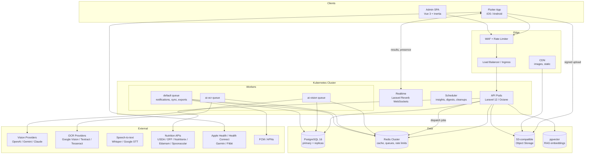
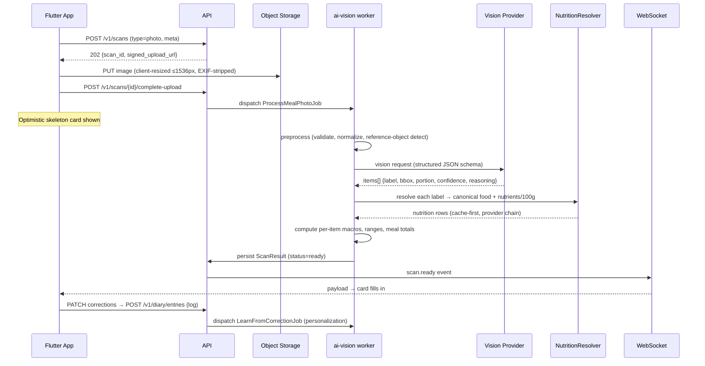

# CalorieLens AI — System Architecture

## 1. Overview

A modular monolith (Laravel 12) deployed on Kubernetes, structured along domain boundaries so the highest-load domains (AI inference orchestration, media processing) can be split into services without rewrites. Mobile is Flutter, offline-first. All AI work is asynchronous and event-driven.



## 2. Why a modular monolith first

- One deployable, one schema, transactional integrity across diary/foods/users — fastest path to GA.
- Domain modules (`app/Domain/{AI,Nutrition,Recognition,Diary,Coaching,Gamification,Social,Admin}`) communicate only via contracts and domain events. No cross-module Eloquent relations across boundaries.
- Extraction order when scale demands: ① media/vision pipeline (stateless, bursty, GPU-adjacent) → ② nutrition search (read-heavy, embeds well behind its own cache) → ③ coaching/LLM service.
- Events already flow through a bus (Redis streams via Laravel events); swapping the transport to SNS/SQS or Kafka is a config change in the event dispatcher, not a refactor.

## 3. Meal photo recognition flow (the core loop)



Latency budget (p95 ≤ 6 s): upload 1.2 s · queue wait 0.3 s · preprocess 0.4 s · vision 2.8 s · nutrition resolve 0.6 s (cache-hit 0.05 s) · persist+push 0.4 s. Poll fallback (`GET /v1/scans/{id}`, 1 s interval) when WebSocket unavailable.

### Pipeline stages (all in `app/Domain/Recognition/Pipeline/`)

1. **Preprocess** — MIME/content sniffing, image-bomb guard, downscale, EXIF strip (server-side again, defense in depth), perceptual hash (dedupe repeated scans → cached result), reference-object detector (utensils/cards/coins/plate via vision prompt) producing a px→mm scale hint.
2. **Detect & identify** — provider-agnostic structured-output call. Multi-angle/video: each frame independent, then a fusion step (weighted by per-frame confidence; portion = trimmed mean; identity = majority vote with tie → ask user).
3. **Decompose** — if dish matches a `composite_dish` template (nasi lemak, fried rice…), expand into components with template ratios, scaled by detected total volume.
4. **Portion estimate** — combines: vision estimate, reference-object scale, depth map volume (when uploaded by app), per-user portion priors. Outputs grams + confidence + range.
5. **Nutrition resolve** — label → canonical `food_items` row via search (exact → trigram fuzzy → embedding similarity); cooking-method modifiers applied (grilled vs fried multipliers from `cooking_modifiers` table).
6. **Compose result** — totals, meal-level range (root-sum-square of item variances), reasoning strings, persists `scan_results` + `scan_result_items`.
7. **Before/after** — second photo links to the original scan; vision computes per-item remaining fraction; consumed = before × (1 − remaining).

## 4. Event-driven backbone

Domain events (Redis streams, consumed by listeners; replayable):

| Event | Consumers |
|---|---|
| `ScanCompleted` | diary suggester, AI usage metering, accuracy sampler (sends 1% to eval queue) |
| `DiaryEntryLogged` | streaks/XP, daily insight aggregator, coach context cache invalidation |
| `EntryCorrected` | personalization learner (portion priors, label remaps), model eval logger |
| `WeightLogged` | trend recomputation, projection update, milestone badges |
| `BarcodeUnknown` | community submission creation, moderation queue |
| `WaterGoalMissed` (scheduled) | reminder notification |
| `ProviderDegraded` | circuit breaker state, ops alert |

## 5. Caching strategy (Redis)

| Layer | Key pattern | TTL |
|---|---|---|
| Nutrition lookups | `nutr:{source}:{hash(query)}` | 30 d |
| Food search results | `search:{locale}:{hash(q)}` | 24 h |
| Barcode products | `barcode:{ean}` | 7 d |
| Scan dedupe | `phash:{user}:{hash}` | 6 h |
| Coach context (today's log summary) | `coach:ctx:{user}:{date}` | until next log event |
| Dashboard aggregates | `dash:{user}:{date}` | write-through on log |
| API rate limits | `rl:{tier}:{user}:{route-group}` | sliding window |

## 6. Scalability profile

- **API pods:** stateless Octane (Swoole), HPA on CPU + p95 latency; 1 pod ≈ 600 rps for read paths.
- **Queue workers:** KEDA-scaled on queue depth; `ai-vision` pool sized by provider rate limits, not CPU.
- **PostgreSQL:** primary + 2 read replicas; diary reads, search, dashboards on replicas. `diary_entries` partitioned monthly by `logged_at`; `scan_results` partitioned + 90-day retention to cold storage.
- **Search:** Postgres FTS + pg_trgm at launch (sufficient to ~5M foods); Meilisearch drop-in behind `FoodSearchContract` when multi-language ranking demands it.
- **Media:** client-side resize, S3 multipart, CDN with image transform (thumbnails on the fly), originals lifecycle-deleted per privacy policy.
- **Cost control:** vision calls are the dominant cost — perceptual-hash dedupe, per-tier quotas, "easy case" router (single packaged item w/ barcode visible → skip vision), provider price arbitrage.

## 7. Admin panel architecture

Inertia.js + Vue 3 SPA served from the same Laravel app under `/admin`, separate auth guard (session + 2FA mandatory), RBAC roles: `super_admin`, `moderator`, `nutritionist`, `analyst`, `support`. Modules: user management, food DB CRUD with versioned nutrition edits, moderation queue (side-by-side OCR/photo diff), AI ops dashboard (per-provider latency/error/cost, confidence distributions, correction rates by food class), reports, audit log browser.

## 8. Wearable & health platform sync

Mobile-side bridges (HealthKit / Health Connect) read steps, active energy, heart rate, sleep, workouts → batched `POST /v1/health/sync` (idempotent, device+interval keyed). Garmin/Fitbit via server-side OAuth webhooks. A nightly job (and on-sync trigger) recomputes adaptive calorie target: `target = BMR × activity_factor + EAT_adjustment − goal_deficit`, smoothed over 7 days to avoid yo-yo targets.

## 9. Failure modes & graceful degradation

| Failure | Behavior |
|---|---|
| All vision providers down | Scan queues with "We'll process this shortly" + instant fallback to search/favorites; circuit breaker probes half-open every 60 s |
| Nutrition API down | Serve from 30-day cache + internal DB; missing nutrients flagged "approximate" |
| Redis down | API degrades to DB-direct with tightened rate limits; queues fail over to database driver |
| WebSocket down | Client auto-falls back to polling |
| Postgres replica lag > 10 s | Read traffic shifts to primary, alert fires |
| Device offline | Full local diary; mutation queue with vector-clock-free last-write-wins per field + server reconciliation (see mobile doc §6) |
```
