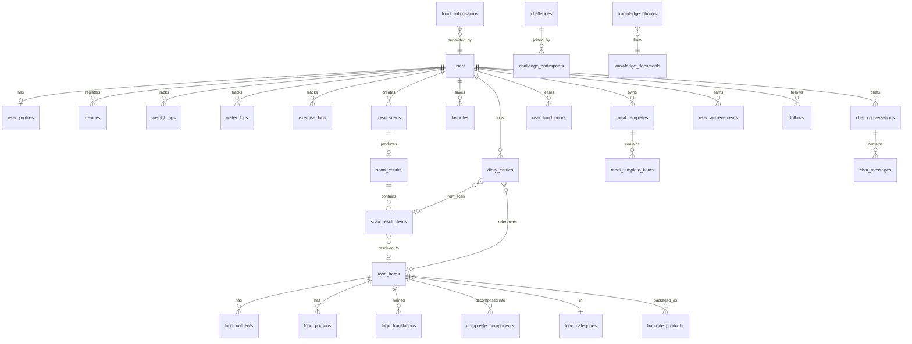

# CalorieLens AI — Database Design

PostgreSQL 16. Full DDL in [`03-schema.sql`](03-schema.sql). UUIDv7 primary keys (time-ordered, index-friendly). All timestamps `timestamptz`. Soft deletes only where user-recoverable (diary, foods); hard deletes + audit elsewhere.

## ER overview

## Key design decisions

### 1. Canonical foods vs. denormalized diary entries
`food_items` + `food_nutrients` (per 100 g/ml, EAV-lite with a fixed nutrient enum) is the canonical store. But `diary_entries` **snapshots** computed nutrition (`kcal, protein_g, carbs_g, fat_g, fiber_g, sugar_g, sodium_mg`) at log time. Rationale: diary history must be immutable when the food DB is later corrected; dashboard aggregation never joins the food graph; offline clients can write complete rows.

### 2. Nutrient storage
Fixed columns for the 7 headline nutrients on `food_nutrients_core` (hot path, covering index) + `food_nutrients_extended` JSONB for the long tail (vitamins, minerals, amino acids — Cronometer-style depth later without 40 columns now).

### 3. Composite dish decomposition
`composite_components(parent_food_id, component_food_id, default_ratio, typical_grams)` — nasi lemak → 7 component rows. The recognition pipeline expands matches; users edit components, not the parent. Curated by nutritionists in admin, versioned via `food_revisions`.

### 4. Provenance & verification
Every `food_items` row carries `source` (`curated|usda|off|nutritionix|edamam|spoonacular|community|user`), `source_ref`, `verification` (`verified|community|unverified`), and `locale_origin`. Search ranking boosts verified + regional matches. All edits append to `food_revisions` (admin audit + rollback).

### 5. Personalization tables
`user_food_priors(user_id, food_item_id, kind)` where kind ∈ `portion_bias` (user's grams vs. predicted, EW-moving average), `label_remap` (model said X, user corrects to Y ≥2 times), `usual_meal` (frequent scan fingerprint → saved correction set). Read by the pipeline as stage-4 inputs; capped per user, LRU-evicted.

### 6. Scans & retention
`meal_scans` (request, media keys, status) is split from `scan_results` (model output) so retries/multi-angle attach N media to one logical scan. `media_objects.purge_after` implements the privacy default: original photos deleted 24 h post-processing unless `users.keep_photos = true`. Results (no image) keep 90 days hot, then archived.

### 7. Partitioning & volume
Monthly range partitions: `diary_entries`, `meal_scans`, `scan_results`, `water_logs`, `exercise_logs`, `audit_logs`, `ai_usage_events`. At 300K MAU × 2.2 meals/day ≈ 20M diary rows/month — partition pruning keeps the dashboard date-range queries on 1–2 partitions.

### 8. Search
`food_search` materialized view: `tsvector` (per-language configs) + `pg_trgm` on normalized names + translations, ranked by `verification`, regional match, global popularity, and per-user frequency (joined at query time from `user_food_stats`). Swappable for Meilisearch behind the same contract.

### 9. RAG store
`knowledge_documents` (curated nutrition guidelines, food science, dietary pattern refs with citations) → `knowledge_chunks(embedding vector(1536))` via pgvector, HNSW index. Coach retrieval = top-k cosine + recency/authority re-rank.

### 10. Gamification & social
`achievements` (static catalog) / `user_achievements`; `user_stats` single-row-per-user counters (xp, level, current_streak, longest_streak — updated via events, never recomputed on read). Social kept minimal and isolated (`follows`, `shared_meals`, `groups`, `challenges`) so it can be carved out later.

## Integrity rules worth noting

- `diary_entries.entry_date` is a `date` in the **user's timezone at log time** (stored explicitly) — daily totals must not shift when users travel.
- Idempotency: `diary_entries.client_uuid` unique per user — offline clients can safely retry.
- `health_sync_batches` unique on `(user_id, provider, period_start, period_end, metric)` — wearable double-imports are no-ops.
- Money-free schema: subscriptions store only entitlement state; billing lives in Stripe/RevenueCat, webhooked into `subscription_events`.
